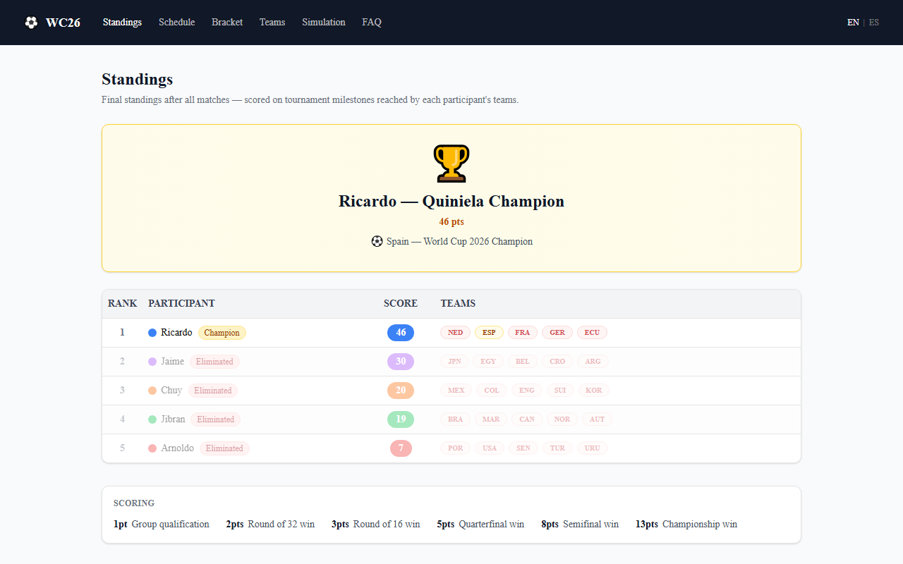

# Quiniela Mundial 2026 Dashboard

[](https://github.com/ricardogr07/wc26-dashboard/actions/workflows/ci.yml)
[](LICENSE)
[](#)

Tournament dashboard for a 5-person FIFA World Cup 2026 prediction pool (quiniela) — standings, match schedule, knockout bracket, team ownership, and Monte Carlo win probabilities.

**Live site:** <https://mango-mushroom-0a45d2a0f.7.azurestaticapps.net>

> 🏆 **Tournament over — Ricardo won the quiniela with 46 points.** Spain beat Argentina 1–0 in the final (July 19, 2026). The site is now a fully static archive: the final standings, matches, and simulation are baked in as JSON snapshots under `web/public/data/`, and the Azure backend (Functions + Cosmos DB) has been retired. See the in-app FAQ page for the full story.



## Stack

| Layer | Technology |
|---|---|
| Frontend | Next.js 16 + TypeScript + Tailwind CSS + Recharts |
| Backend | Azure Functions (Python 3.11, Flex Consumption) — retired post-tournament |
| Database | Azure Cosmos DB — retired post-tournament |
| Hosting | Azure Static Web Apps |
| IaC | Terraform |
| CI/CD | GitHub Actions |

## Features

- **Standings** — ranked table with each participant's score and team ownership
- **Schedule** — full match list with round filter and participant team highlights
- **Bracket** — knockout bracket from Round of 32 to the final
- **Teams** — ownership grid sortable by participant, name, or score; filterable by status
- **Simulate** — Monte Carlo win probabilities (10 k runs); during the tournament a Scenario Builder let you fix hypothetical results and compare shifted odds against the baseline
- Bilingual UI (English / Spanish)

## Quick start

The site is fully static — no backend, database, or API keys needed:

```bash
cd web
pnpm install
pnpm dev        # http://localhost:3000 — serves the archived final data
```

### Running the full stack (as it ran during the tournament)

The retired backend still runs locally if you want to explore it. It needs a Cosmos DB to talk to — either a real account or the [Cosmos DB emulator](https://learn.microsoft.com/en-us/azure/cosmos-db/emulator) started separately (`scripts/setup_emulator.py` creates the database and container); docker-compose only provides Azurite, the storage emulator:

```bash
cp .env.local.example .env.local
# Fill in COSMOS_CONNECTION_STRING, ADMIN_API_KEY, THESPORTSDB_API_KEY

docker compose up --build
# API: http://localhost:7071
# Web: http://localhost:3000

# Seed the database (first run only)
uv run python scripts/seed_cosmos.py
```

See [docs/setup.md](docs/setup.md) for the full setup guide, manual (no Docker) path, and env var reference.

## Documentation

| Doc | Contents |
|---|---|
| [docs/setup.md](docs/setup.md) | Local dev setup, env vars, seeding, running tests |
| [docs/architecture.md](docs/architecture.md) | System overview, data flow, data models, repo structure |
| [docs/simulation.md](docs/simulation.md) | Monte Carlo engine, Elo model, scenario builder, scoring |
| [docs/deploy.md](docs/deploy.md) | GitHub Secrets, Terraform setup, deploy pipeline, infra notes |

## Repository structure

```
wc26-dashboard/
├── .github/            CI workflows and composite actions
├── api/                Azure Functions (handlers, models, simulation engine, tests)
├── docs/               Setup, architecture, simulation, deploy guides
├── infra/              Terraform + ARM template
├── scripts/            Seed, fixture generation, smoke tests
├── shared/seed/        Static data (participants, teams, group-stage fixtures)
├── web/                Next.js app (pages, components, API client)
│   └── public/data/    Final tournament data — the static archive's source of truth
├── docker-compose.yml
└── function_app.py     Azure Functions entry point
```
